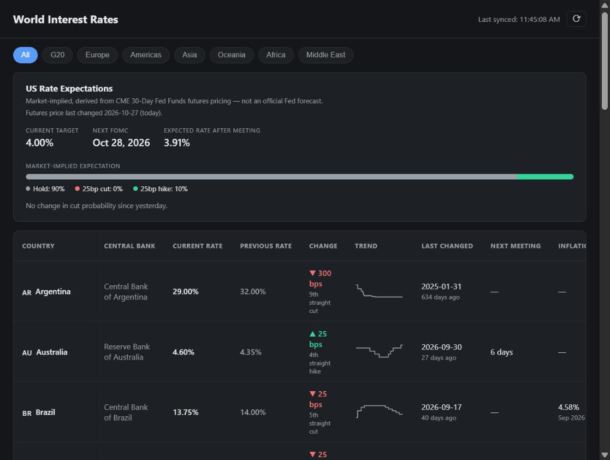

# World Interest Rates Dashboard

A free, self-hosted "what's the current policy rate, right now" dashboard for
major central banks — plus a small API (protected by an API key) that other
tools can query for the same cached data.

**Live:** https://world-interest-rates.onrender.com/



## What it shows

- **Policy rates for 27 economies**, with the last change in basis points,
  the date it happened, and a trend sparkline built from stored history.
- **Next meeting date** for the US, Euro Area, UK, Australia and Canada.
  The US FOMC calendar refreshes itself from federalreserve.gov
  (`src/sources/fedCalendar.js`).
- **Headline inflation (CPI YoY) and real rate** for the US, Euro Area, UK,
  Canada and Brazil (FRED, Eurostat, ONS, StatCan, BCB).
- **FX rate vs USD** from frankfurter.dev (ECB reference rates).
- **US rate expectations** for the next FOMC meeting, derived from EFFR and
  CME 30-Day Fed Funds futures (`src/sources/rateExpectations.js`).

## How it's built

```
Free upstream sources (FRED, ECB, BoE, BoC, BCB, BIS)
        │  polled on a schedule (never per page-view)
        ▼
   Sync worker (src/sync)  →  SQLite / Turso cache
        │
        ├── /w/f                 (dashboard feed — same-origin browser + signed cookie)
        ├── /api/v1/rates[...]   (requires X-Api-Key — for external consumers)
        └── /internal/sync       (requires X-Sync-Secret — cron trigger)
```

- **Data is never fetched live on a page view.** A background sync writes to
  the local cache; both the dashboard and the keyed API only ever read from
  that cache. This is what keeps it free — no risk of hammering a rate limit
  or getting an IP blocked no matter how many people load the page.
- **Deltas (bps change) are always computed locally** by comparing the new
  value to what we last stored — never trusted from an upstream "change"
  field.
- **"Fast lane" sources** (FRED, ECB, BoE, BoC, BCB) are dedicated,
  near-real-time feeds for five economies (US, Euro Area, UK, Canada,
  Brazil). **Everything else** falls back to the BIS policy-rate database,
  which is free and covers the other 22 countries (27 in total), at the cost of a several-day lag versus the
  fast-lane sources (see `api/src/sources/bis.js`).

## Data sources (all free, verified live on 2026-09-12)

| Source | Countries | Auth | Typical lag |
|---|---|---|---|
| FRED (St. Louis Fed) | US | Free API key | 0-1 day |
| ECB Data Portal (SDMX) | Euro Area | None | 1-2 days |
| Bank of England (IADB CSV) | UK | None | 1-2 days |
| Bank of Canada (Valet API) | Canada | None | 3-4 days |
| Central Bank of Brazil (SGS) | Brazil | None | 0 days |
| BIS policy rate DB (SDMX) | 22 more countries | None | ~1 week |
| Yahoo Finance chart API (unofficial) | US rate expectations (ZQ futures) | None | intraday |
| frankfurter.dev | FX vs USD | None | 1 day |

The Yahoo endpoint is the one unofficial source: it has no published
contract and could change or block requests without notice. Every sync
validates the response before using it.

Deliberately **not** used: Trading Economics (paid only) and Finnhub (no
central-bank data on any tier, paid or free). API-Ninjas was evaluated as a
gap-filler but skipped by default — its free tier is 3,000 calls/month and
**prohibits commercial use**; wire it in under `src/sources/` only if this
stays non-commercial.

### Adding FRED

FRED requires a free API key (no credit card): register at
https://fred.stlouisfed.org/docs/api/api_key.html and set `FRED_API_KEY`.
Without it, the US row simply logs a sync error and is skipped — nothing
else breaks.

## Running locally

```bash
cp api/.env.example api/.env
# edit api/.env: set API_KEYS, SYNC_SECRET, and FRED_API_KEY if you have one
docker compose up --build
```

Then:
- Dashboard: http://localhost:3000
- Keyed API: `curl -H "X-Api-Key: <your key>" http://localhost:3000/api/v1/rates`
- Manual sync trigger: `curl -X POST -H "X-Sync-Secret: <your secret>" http://localhost:3000/internal/sync`
- Recent sync runs: `curl -H "X-Sync-Secret: <your secret>" http://localhost:3000/internal/sync-log`

Optional: set `DASHBOARD_TOKEN_SECRET` only if you run several instances
that must accept each other's dashboard cookies. By default a random secret
is generated on every boot.

The first boot auto-runs a sync if the database is empty, so the dashboard
is never blank on a fresh start.

## Deploying for free

**1. Database — Turso (free forever tier, no card required)**

```bash
# Install the Turso CLI, then:
turso auth signup
turso db create world-rates
turso db show world-rates --url          # → TURSO_DATABASE_URL
turso db tokens create world-rates        # → TURSO_AUTH_TOKEN
```

Set both as environment variables on your host. Without them the app falls
back to a local SQLite file — fine for local dev, but that file is wiped
whenever a free container host redeploys/restarts, so use Turso in
production.

**2. Hosting — Render.com (free Web Service, Docker, no card required)**

1. Push this repo to GitHub.
2. On Render: New → Web Service → connect the repo → "Docker" runtime,
   Dockerfile path `api/Dockerfile`, root context `.`.
3. Add environment variables: `TURSO_DATABASE_URL`, `TURSO_AUTH_TOKEN`,
   `API_KEYS`, `SYNC_SECRET`, `FRED_API_KEY`, `DISABLE_INTERNAL_CRON=true`.
4. Deploy. Render gives you a `https://<app>.onrender.com` URL.

Any other Docker-friendly free host (Fly.io, Railway, etc.) works the same
way — the app has no Render-specific code.

**3. Keep it awake and fresh — cron-job.org (free, no card)**

Render's free tier sleeps after ~15 minutes idle, which would also stall an
in-process cron. Instead, create a free job at https://cron-job.org that
runs every 15-30 minutes:

- URL: `https://<your-app>.onrender.com/internal/sync`
- Method: `POST`
- Header: `X-Sync-Secret: <your SYNC_SECRET>`

This single external ping both wakes the app and triggers the refresh, so
freshness doesn't depend on the container staying alive between requests.
(`DISABLE_INTERNAL_CRON=true` turns off the redundant in-process scheduler
in this setup — leave it unset if you deploy somewhere that stays awake and
prefer self-contained scheduling instead.)

## API reference

### `GET /api/v1/rates`
Requires `X-Api-Key`. Optional query params: `region` (Europe, Americas,
Asia, Oceania, Africa, Middle East), `tag` (e.g. `G20`).

### `GET /api/v1/rates/:code`
Requires `X-Api-Key`. `:code` is the country code (e.g. `US`, `EA`, `GB`).

### `GET /w/f`
The dashboard's own feed, called by `public/app.js`. Not a public API: it
requires a same-origin browser request and a short-lived HMAC-signed cookie
issued when the page loads, and is rate-limited to 30 requests a minute.
Use `/api/v1/rates` with a key for programmatic access.

### `POST /internal/sync` and `GET /internal/sync-log`
Require `X-Sync-Secret`. Trigger a sync, or list recent sync runs.

## Known limitations / next steps

- `next_meeting_date` for the ECB, BoE, RBA and BoC is hand-maintained in
  `src/config/meetingCalendars.js` — refresh it once a year. The US calendar
  updates itself. Other countries show no countdown.
- No automated tests yet.
- API keys are a flat env-var list — fine for a handful of hand-issued
  keys; swap in a DB-backed table with hashed keys if you need self-serve
  issuance/revocation later.
- SNB, Banxico, BOJ, and RBNZ each have free structured data (see the
  sourcing research), but weren't wired up as fast-lane sources in this
  first pass — they're covered via the BIS fallback for now.
